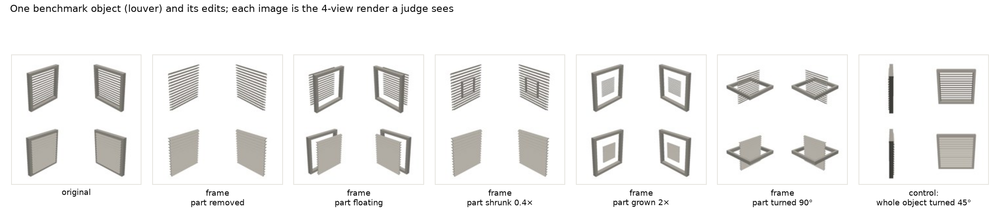
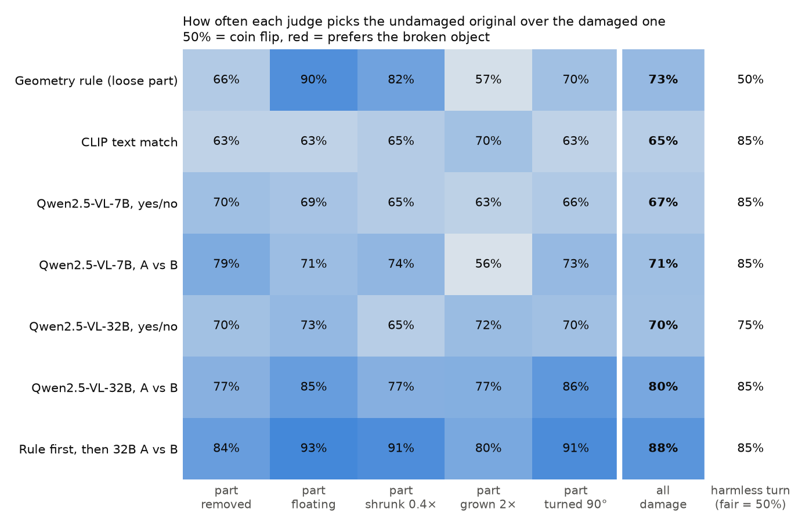
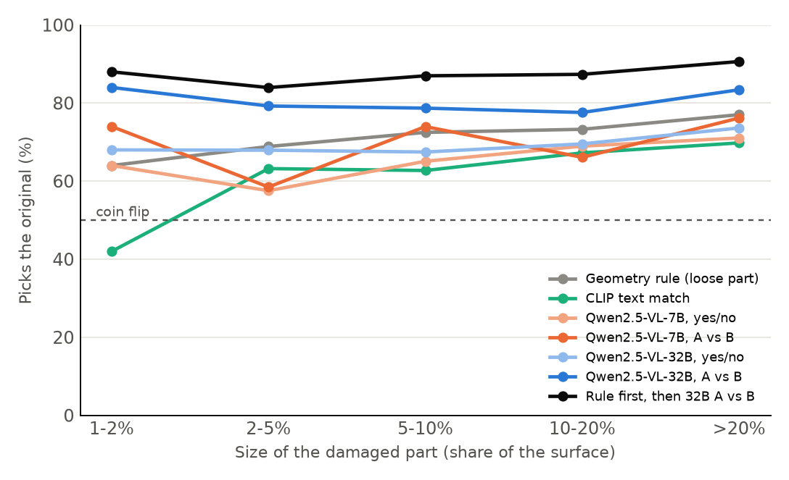
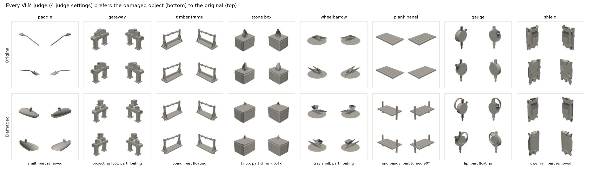

# Sand3D Judge Bench

**Do 3D judges notice when a part of an object is broken? A benchmark with exact labels, built from [Sand3D](https://huggingface.co/collections/Sandflow/sand3d) programs.**

Vision-language models (VLMs) and CLIP are often used to judge generated 3D objects: to filter data, to rank samples, or as a reward. It is hard to measure how good these judges are, because labelling 3D quality by hand is slow and subjective.

Sand3D programs make it possible to build such a test automatically. Every object is a short program with **named parts** (`seat`, `table_leg.001`, `handle`, ...). So we can damage one part in a known way (remove it, detach it, shrink it, ...) and get a pair of objects where **we know for sure which one is correct**. No human labels are needed, and the benchmark can grow to any size.



## Main result

150 objects from the Sand3D-Objaverse validation split, 5 kinds of damage, 734 visible damage pairs. The table shows how often each judge picks the undamaged original (50% = coin flip). The 95% intervals come from resampling objects.

| Judge | Picks the original | Same object turned 45° (fair = 50%) |
|---|---|---|
| Geometry rule (any loose part) | 73% [71, 75] | 50% |
| CLIP text match (ViT-L-14) | 65% [60, 69] | 85% |
| Qwen2.5-VL-7B, yes/no on each object | 67% [62, 72] | 85% |
| Qwen2.5-VL-7B, A vs B | 71% [67, 74] | 85% |
| Qwen2.5-VL-32B, yes/no on each object | 70% [65, 74] | 75% |
| Qwen2.5-VL-32B, A vs B | **80%** [77, 84] | 85% |
| **Rule first, then Qwen2.5-VL-32B A vs B** | **88%** [85, 90] | 85% |



### Findings

1. **Single-object scores are weak, even for a 32B model.** Asked "is this object correctly built?", Qwen2.5-VL picks the right one only 67% (7B) and 70% (32B) of the time. CLIP gets 65%.
2. **Comparing helps more than model size.** Showing both objects side by side lifts the 32B judge to 80%. The same model scoring objects one at a time gets 70%.
3. **A simple geometry rule and a VLM catch different things.** The rule (does any part come loose?) is best at floating parts (90%), but it says nothing about 54% of the damage. Using the rule first and the VLM for the rest gives 88%, the best result across all damage types and part sizes.
4. **Judges react to the camera angle more than to most damage.** Turning the whole object by 45° is harmless, yet every VLM and CLIP prefers the original 75–85% of the time. Part of this is real: after the turn the cameras look straight at the faces of the object and see less of it (see the control in the figure above). Still, it means a judge's score depends a lot on the pose and the cameras, not only on the shape.
5. **Small parts are where the judges fail.** When the damaged part is 1–2% of the surface, CLIP is below chance (42%).
6. **Some clearly broken objects fool every judge.** 6% of the damaged objects are preferred by all four VLM settings: a paddle with no shaft, a wheelbarrow with a floating tray, a gauge with a floating rim.





## How it works

**Pairs** (`build_pairs.py`)
- Each program is run with `sand3d` and its parts are read from the exported GLB.
- Copies of a part (`table_leg`, `table_leg.001`, ...) form a group and are damaged together.
- Objects are skipped if they have fewer than 3 parts or more than 150, or if they already have a loose part.
- The largest group (the main body) is never damaged. Damaged groups cover at least 1% of the surface.

| Edit | What happens to one part group |
|---|---|
| remove | the group is deleted |
| float | the group moves 15% of the object size away from the centre |
| shrink / grow | each copy is scaled by 0.4× / 2× around its own centre |
| rotate | the group is turned 90° around a horizontal axis |
| same (control) | identical copy |
| turn (control) | the whole object is turned 45° around the vertical axis |

Damage must be visible. If an edit changes less than 0.5% of the pixels, another part group is tried (up to 4). 98% of the damage pairs are visible, and the rest are left out.

**Rendering** (`render.py`): a small CPU renderer draws four grey clay views from fixed cameras in one 1024×1024 image. This is what every judge sees.

**Judges** (`judge.py`)
- *yes/no*: the score is the mean of P(Yes | "Is it correctly built?") and P(No | "Does it have a construction defect?"). The prompt names the object ("should be a wheelbarrow") and lists the defects to look for. The original wins if it scores higher.
- *A vs B*: both renders are shown and the model is asked which one is built correctly. It is asked in both orders and the two answers are averaged, because the models strongly prefer one position: on identical pairs Qwen-32B picks the first image 84% of the time.
- *CLIP*: the mean cosine similarity between the four views and "a 3D model of a {name}".
- *Geometry rule*: an edit is flagged if more than 1% of the surface is outside the largest group of touching parts. If nothing is flagged, the rule has no opinion and counts as a coin flip.

Two details mattered for correct numbers:
- **Scoring one image at a time.** Batching with padding shifted the scores of identical images by about 0.007, which is about as large as the effects.
- **Starting the 32B model's answer.** Qwen-32B tends to start with "To determine…" instead of "1" or "2". Starting its answer with "The correctly built one is Image " fixes this. `analyze.py` stops with an error if a judge's probability on its answer words is low.

## Limitations

- 150 objects and two model families (Qwen2.5-VL and CLIP). Frontier models (GPT, Claude, Gemini) were not tested.
- The damage is synthetic and made at the mesh level. Errors from a real generator may look different.
- "Grown 2×" is sometimes a plausible design, not a defect. All judges, including the rule, do worst there.
- The turned control also changes what the cameras can see, so it measures view sensitivity, not pure bias.

## Next steps

- Run the same pairs on frontier VLMs and on the judges used in production.
- Damage the **program parameters** instead of the meshes, so the errors look like a code model's mistakes.
- Use the free, unlimited pairs to **train** a judge, then check whether it holds up when a generator is optimised against it.

## Reproduce

```bash
pip install -r requirements.txt     # Python 3.13 (sand3d ships Blender's bpy)
./run.sh                            # data -> pairs -> judges -> figures
```

Tested on one 96 GB GPU. Building takes about 25 min, CLIP 2 min, Qwen-7B 35 min and Qwen-32B 2 h. The figures and numbers can be remade on a laptop from the saved results with `python analyze.py`. `SMOKE=3 python build_pairs.py` is a quick test.

```
prepare_data.py   step 1: download the validation split
build_pairs.py    step 2: run programs, damage named part groups, render
render.py         CPU renderer (4 clay views)
judge.py          step 3: CLIP and Qwen2.5-VL judges
analyze.py        step 4: numbers (results/summary.txt) and figures
results/          pairs.csv, judge_*.csv, summary.txt, thumbs.zip (200 px renders of every pair; analyze.py unzips it)
figures/          the figures above
```

In `results/judge_*.csv`, `pref` is how strongly the judge prefers the original, from 0 to 1, where 0.5 means no preference.

## Data

Objects come from [Sandflow/sand3d-objaverse](https://huggingface.co/datasets/Sandflow/sand3d-objaverse) (CC-BY-4.0), built with the [sand3d](https://github.com/Sandflow-ai/sand3d) library from [Objaverse](https://arxiv.org/abs/2212.08051) objects. The original objects are credited row by row in the dataset. The renders in `results/thumbs.zip` are derived from them under the same license.
